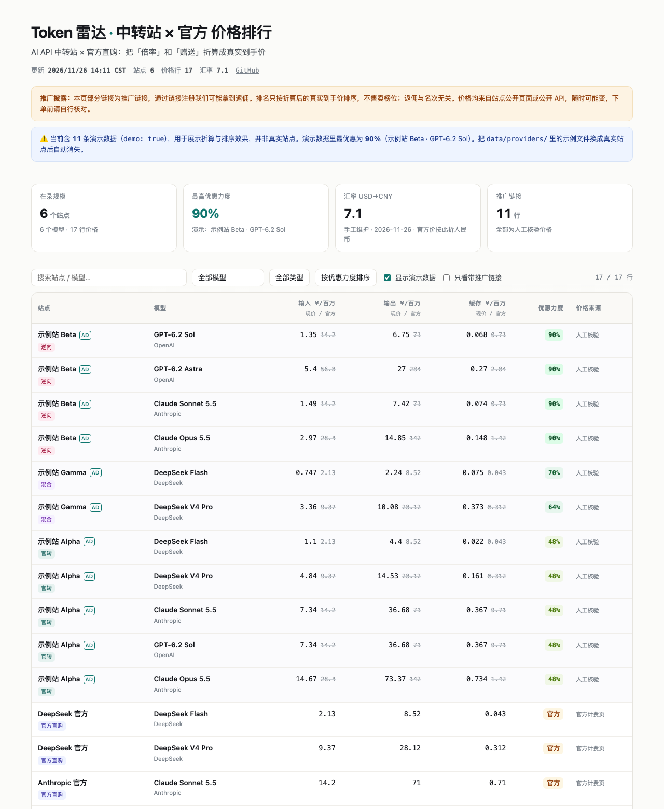

# Token 雷达 · AI 中转站 × 官方 价格排行

把 AI API 中转站的「倍率」「充值赠送」「计费虚高」折算成**人民币 / 百万 token 的真实到手价**，再和官方直购价对齐比较。GitHub Actions 定时抓取 + 探活，静态站一键部署到 Pages。

**在线站：<https://wunankun.github.io/token-radar/>** ｜ 仓库：<https://github.com/wunankun/token-radar>



> 仓库里的 `demo-alpha / demo-beta / demo-gamma` 是**演示数据**（`demo: true`），只为展示折算和排序效果。换成真实站点后自动消失。

---

## 为什么需要一个「折算过」的榜单

打开任何一个中转站，你看到的价格有三种完全不同的口径：

| 站上写的 | 实际含义 | 真实成本 |
| --- | --- | --- |
| `0.5 倍率` | 官方**美元价** × 0.5，但以**人民币**结算（行业「1 元 = 1 美元」惯例） | ≈ 官方人民币价的 7%（便宜 14 倍） |
| `官转 6.2 折` | 官方**人民币**价 × 0.62 | 官方人民币价的 62% |
| `充 100 得 120` | 单价再打 0.83 折，但榜单通常只抄标价 | 标价 × 0.83 |

再叠加**计费虚高**（同样的 prompt，站上报出的 usage 是官方的 1.3 倍以上），一张「按标价排序」的榜单，排名和真实成本基本无关。

这个项目只做一件事：**把上面三层全部算进去，然后按真实到手价排序。**

```
实际到手价 = 标价 × 计费系数 ÷ 充值赠送倍数
混合成本   = 0.7 × 输入价 + 0.3 × 输出价        # config.json 可改，表里的「现价」
优惠力度   = 1 − 现价 ÷ 官方价                  # 百分比越大越优惠，负数表示比官方贵
```

榜单按「优惠力度」从大到小排，官方直购作为基准行（优惠力度显示「官方」）。

倍率的口径在数据里用 `base` 字段区分，混用会算出完全错误的排名：

- `base: "usd_official"` —— 倍率乘官方美元价，以人民币结算（逆向/低价站常见）
- `base: "cny_official"` —— 倍率乘官方人民币价（官转常见）

---

## 快速开始

零依赖，只要 Node ≥ 18。

```bash
git clone https://github.com/wunankun/token-radar && cd token-radar
node scripts/build.mjs          # 生成 dist/index.html + dist/prices.json
open dist/index.html            # 直接看

node --test tests/              # 抓取链路单测（本地假站点，不联网）
node scripts/demo-crawl.mjs     # 看抓取+比价整条链路跑一遍
```

构建时会做硬校验（不通过直接失败）：

- 模型 id 必须在 `data/models.json` 登记
- 有推广链接（`affiliate.url`）就必须写 `"disclosure": true`
- 倍率模式必须有官方基准价，否则无法折算
- 每个站点的价格要能回溯到 `pricing_url`

### 模型目录与热度

`data/models.json` 里每个模型有 `label` / `vendor` / `aliases` / `popularity`，其中 **`popularity`（0–100）只是兜底的先验值**，页面上的排序由数据算：

| 情形 | 热度怎么来 | `meta.heat.source` |
| --- | --- | --- |
| 库里有真实站点（`demo` 不为 `true`、且不是官方直购行） | `coverage`：有几家中转站在卖这个模型，归一化成 0–100（卖得最多的那个是 100） | `coverage` |
| 只有演示数据 / 一个真实站都没有 | 回落到 `popularity` 人工值 | `manual` |

- 页面上的模型筛选是**两栏级联面板**：点开先看左栏公司，右栏是这家公司的模型；公司按自家最热的模型排先后，右栏第一项「全部 X 模型」可以整家筛；
- 右栏每个模型后面会显示「N 站」——这就是它被几家收录，也是热度的原始数据。同一模型被越多站收录，热度越高；
- 官方直购行和 `demo: true` 的演示站**不计入** coverage，否则基准行会把每个模型都抬高一次；
- 缺 `popularity` 只产生 warning（先验排最后），超出 0–100 直接构建失败。
- 想让某个模型在**还没有真实数据时**排前面，就临时改 `popularity`；接上真实站点后它会被 `coverage` 自动顶掉，不需要手工维护。

---

## 数据从哪来

| 来源 | 做法 | 标记 |
| --- | --- | --- |
| 官方价 | 人工读厂商计费页，记录 `verified_at` 与来源链接（`data/official.json`） | 官方计费页 |
| 中转站价（人工） | 编辑 `data/providers/<id>.json` | 人工核验 |
| 中转站价（自动） | `fetch-pricing.mjs` 拉 new-api / one-api 的公开 `GET /api/pricing` | 自动抓取（未核验） |
| 可用率 | 有 key 的站点探活，只统计最近 7 天（`data/health/`） | 后台记录，不占榜单列 |

自动抓取当前**手动触发**（`node scripts/fetch-pricing.mjs --write`），定时任务还没开，原因见下面「抓取」一节。

自动抓取只写 `data/observed/`，**人工确认后才进 `data/providers/`**。因为 `/api/pricing` 返回的是「站内面值」，只有确认了这站是「1 元 = 1 美元」还是按汇率收人民币，才能正确换算成人民币价。

官方价里还有几个现实变量，先按标准档记录，明细都在 `data/official.json` 的 `note` 里：

- DeepSeek 有峰谷价（谷时 5 折）
- Anthropic 有 5 分钟 / 1 小时缓存写入价、100K 以上长上下文加价
- OpenAI 有 Batch / 长上下文档

---

## 抓取

中转站大多跑 new-api / one-api，它们暴露一个公开接口 `GET /api/pricing`，返回每个模型的 `model_ratio`。按 one-api 的计费口径（1 USD = 500,000 quota），**USD / 百万 token = model_ratio × 2 × group_ratio**，拿到的正好是站点自己的「倍率价」。

```bash
# 1. 加站：自动发现定价接口、抓一次、写回 data/sources.json
node scripts/fetch-pricing.mjs --add https://某个中转站.com

# 2. 手动维护后的日常抓取
node scripts/fetch-pricing.mjs            # 试跑，只打印
node scripts/fetch-pricing.mjs --write    # 落盘
```

产物：

| 文件 | 内容 |
| --- | --- |
| `data/sources.json` | 待抓站点清单（`enabled: false` 可临时停抓） |
| `data/observed/<id>.json` | 最新一次快照：模型价、`group_ratio`、HTTP 状态、耗时、未匹配的模型名 |
| `data/price-history/<id>.jsonl` | 每次抓取追加一行，用来算涨跌和历史曲线 |
| `data/observed/index.json` | 全部站点最近一次抓取的总览 |

常用参数：

```bash
--only <id>            只抓一个站点
--concurrency 4        并发数（默认 4，别对同一家站压太高）
--timeout 15000        单次请求超时（毫秒）
--retries 2            失败重试次数（只对超时/429/5xx 重试，403 直接放弃）
--fixture <file>       用本地 JSON 跑，不联网
--list                 看看清单里有哪些站
```

会打印出涨跌，方便你一眼看出「哪家悄悄涨价了」：

```
✓ my-station   HTTP 200   312ms  模型 5/6
   ↑ 涨价 gpt-6.2-sol.input 0.9 → 1.08 (+20%)
   新增模型：gpt-6.2-astra
```

### 实测覆盖率（2026-11-26，150 个在营站）

拿 150 个真实在营的中转站域名逐个探 `GET /api/pricing`：

| 结果 | 数量 | 占比 |
| --- | --- | --- |
| 返回模型倍率，可直接解析 | 66 | 44% |
| 接口不存在（404） | 42 | 28% |
| 返回 HTML / 非 JSON（多为 Cloudflare 拦截页） | 55 | 37% |
| 超时或连不上 | 14 | 9% |
| 需要登录（401/403） | 0 | 0% |

抓取成功的 66 个站已经写进 `data/sources.json`，快照在 `data/observed/`。但**抓得到 ≠ 算得对**：

- 66 个站里只有 **24 个**的基准倍率落在官方价的 0.5–1.6 倍之间，可以认为是「正常计价」；其余站的倍率表是另一套单位（中位倍数 2.3× 到 250×），直接乘会算出离谱的价。
- 更要紧的是**折扣藏在分组里**：多数站的 `model_ratio` 表和官方价 1:1 一致，真正的便宜来自 `group_ratio < 1` 的分组。而分组名各站自定义（`Claude Code Kiro`、`gpt-k12`、`国模0.03`…），很多还是限定用途的组，取最小值会得到假便宜。
- 所以自动抓取只产出「观测值」，**人工确认分组倍率后**才进 `data/providers/`。确认方式很简单：在 `data/sources.json` 里给这个站写 `"group_ratio": 0.5`，下次抓取就按这一组折算；`data/observed/<id>.json` 里的 `group_ratios` 字段列出了该站全部分组倍率，供你挑选。

### OpenRouter 对照

`node scripts/fetch-openrouter.mjs --write` 会抓 OpenRouter 的公开价目表写进 `data/observed/openrouter.json`。它覆盖 Claude / GPT / DeepSeek 的主流型号，可以用来交叉验证官方价有没有改过——但它是个聚合商，价格不等于官方直购价，**不要**当成官方基准。

**几个现实情况，先说清楚：**

- **不少站抓不到。** 实测中最常见的是 Cloudflare 人机验证（403）、接口被关（404）、或者压根不是 new-api。脚本会把这些原因翻译成人话打印出来，但结论一样：**只能人工录入**。
- **抓到的只是「面值」。** 站点是「1 元 = 1 美元」还是按汇率收人民币，接口不告诉你。所以自动抓取只写 `data/observed/`，人工确认后手抄进 `data/providers/`（或直接改这份 json 里的 `assumption`）。
- **模型名各站不同。** `claude-3-5-sonnet-20241022`、`claude-sonnet-4-5` 这类写法靠 `data/models.json` 里的 `aliases` 匹配；匹配不上会列在 `unmatched` 里，照着补别名即可。
- **按次计费的模型**（图片、视频）`quota_type = 1`，没有 token 单价，直接跳过，不会算成 0 混进排名。

---

## 加一个站点（带你的推广链接）

一个站点一个文件，`data/providers/<id>.json`。**倍率写在站点级，模型只列它卖哪几个**——这样改价只需要改一个数：

```json
{
  "id": "my-station",
  "name": "某站",
  "kind": "official-relay",
  "homepage": "https://my-site.com",
  "pricing_url": "https://my-site.com/pricing",
  "first_seen": "2026-11-26",
  "price_updated_at": "2026-11-26",
  "multiplier": { "base": "cny_official", "value": 0.62 },
  "affiliate": {
    "url": "https://my-site.com/register?aff=YOUR_CODE",
    "code": "YOUR_CODE",
    "commission": "10%",
    "disclosure": true
  },
  "recharge": { "pay": 100, "get": 120, "note": "充 100 得 120" },
  "billing": { "ratio": 1.0, "measured_at": "2026-11-20" },
  "risk_flags": [],
  "models": {
    "claude-sonnet-5-5": {},
    "gpt-6.2-sol": {},
    "deepseek-v4-pro": { "value": 0.5 },
    "gpt-6.2-astra": { "mode": "absolute", "input": 8.8, "output": 44 }
  }
}
```

`models` 里每条的含义：

| 写法 | 含义 |
| --- | --- |
| `{}` | 完全继承站点级 `multiplier` |
| `{ "value": 0.5 }` | 只覆盖倍率，`base` 仍然继承 |
| `{ "mode": "absolute", "input": 8.8, "output": 44 }` | 直接写人民币/百万 token，不继承 |

用脚手架更快，`--model` 可以重复传：

```bash
node scripts/add-station.mjs --id my-station --name "某站" --kind official-relay \
  --homepage https://my-site.com --pricing https://my-site.com/pricing \
  --aff "https://my-site.com/register?aff=YOUR_CODE" \
  --mult 0.62 --base cny_official \
  --model claude-sonnet-5-5 --model gpt-6.2-sol --model deepseek-v4-pro
```

`kind` 取值：`official`（官方直购）· `official-relay`（官转）· `reverse`（逆向/号池）· `mixed`（混合）· `aggregator`（聚合商）。

`risk_flags` 可选：`unverified` `reverse` `cheap-trap` `billing-inflation` `model-substitution` `no-entity` `operator-self` `ran-away` `no-refund` `prepaid-only` `limited-models`。

完整 schema 见 [`schema/provider.schema.json`](schema/provider.schema.json)。

### 停更一个站点：改一个字段

跑路了、暂停营业、或者你暂时不想推它，都不需要删文件（删了历史价格和推广链接就没了）：

```json
{ "status": "paused" }
```

`status` 三档：`active`（默认，上榜）· `paused`（暂停，不上榜但要观察）· `dead`（已关站，留着存档）。构建会跳过非 `active` 的站点，并在日志里列出来。

---

## 日常维护

这个项目的维护成本刻意压在三件事上：**改一个数、加一个文件、每周跑一次审计**。

| 什么时候 | 做什么 | 花多久 |
| --- | --- | --- |
| 某站调价 | 改它 `multiplier.value`（如果是单个模型调价，才改模型条目） | 10 秒 |
| 有新站要推 | `npm run add -- ...` 生成文件，填推广链接 | 1 分钟 |
| 某站关站 | 把 `status` 改成 `dead` | 5 秒 |
| 每周一次 | `npm run audit`，按清单挑着处理 | 5 分钟 |
| 每月一次 | 对一遍厂商计费页，更新 `data/official.json` 的 `as_of` | 10 分钟 |

`npm run audit` 会扫出这些情况（红=必须处理，黄=建议，灰=看看就好）：

- 官方基准价多久没复核（超过 45 天提醒，超过 90 天报警——它是全站折扣的分母）；
- 哪些站点没写 `price_updated_at`、或价格超过 45 天没核对；
- 抓取失败的站（HTTP 非 200，通常意味着关站或换接口了）；
- 探活可用率低于 90%、或连续 3 天没有成功请求的站；
- 没有推广链接的站（等于白送流量）、推广链接没填邀请码的站；
- 重复收录的域名、非法的 homepage URL；
- 还没替换掉的演示数据、已标记 `paused`/`dead` 的站。

加 `--md` 会输出 Markdown 清单，可以直接贴进 GitHub Issue 当待办：

```bash
npm run audit:md
```

还有一条兜底规则：**数据陈旧不会让站点挂掉，但会让结论变错**。所以 `build` 只做结构校验，时效性判断全部交给 `audit`——它只提醒，不擅自改数据。

---

## 自动化

自动化全在 `.github/workflows/update.yml` 和 `check.yml` 两个文件里。

**现在是手动档：没有开定时任务。** 定时抓取一行注释就能打开——等 `data/sources.json` 里的站点稳定、你也确认了哪些站抓得到之后再说，避免每天几十条 failed 的 commit 把仓库刷脏。

- **手动触发**（Actions 页面点 Run workflow）：抓取 → 探活 → 构建 → 提交 `data/` 与 `dist/` → 部署 Pages
- **push 触发**（改了 `data/**` 或 `scripts/**`）：只构建 + 部署，不动数据

打开定时：

```yaml
# .github/workflows/update.yml 顶部
on:
  schedule:
    - cron: '17 */6 * * *'
```

开启 Pages：仓库 **Settings → Pages → Source: GitHub Actions**。

探活密钥（可选，没有就跳过）：**Settings → Secrets → New repository secret**

```
PROBE_KEYS = {"my-station":"sk-xxxx","another-station":"sk-yyyy"}
```

站点侧再补上（可选）：

```json
"probe": { "base_url": "https://api.my-site.com/v1", "model": "claude-sonnet-5-5" }
```

`probe.mjs` 不存 key、不打印 key，只记录成功/失败、延迟、指纹通过数、`usage ÷ 本地估算` 的比值。

> 注意：GitHub 会在仓库 60 天无提交后自动停用定时任务；本仓库每次运行都会提交 `dist/`，所以不会触发。Fork 后需要先手动跑一次。

---

## 规则（也是这个项目的底线）

1. **排序只看折算后的真实价格**，不看返佣比例、不看谁给的钱多、不卖榜位。
2. **有推广链接必须标注**，构建设置了硬校验，`disclosure: true` 少一个字都过不了。
3. **价格必须可回溯**，每个站点都能点回它自己的定价页。
4. **不推荐、不背书**，只做数据；风险标签和可用率一并展示，判断权在读者。
5. **被站点投诉价格错误 → 先下线，再核实**。

---

## 风险提示

价格低到一定程度，通常意味着渠道不是官方直连。arXiv 上有一篇对影子 API 的实测研究（[Real Money, Fake Models](https://arxiv.org/abs/2603.01919)）：

- 在被学术引用过的 17 个中转站里，**45.83%** 的节点没通过模型身份验证
- 部分影子接口在专业问答上的正确率比官方低 **40 个百分点以上**
- 价格倍率本身**几乎不能预测**这种劣化

所以本站除了价格，还标 `逆向 / 低价陷阱 / 疑似掉包 / 计费虚高`；探活得到的可用率和计费系数在后台记录（`data/health/`），计费系数直接参与「现价」折算。便宜和稳定，自己权衡；重要业务建议直接走官方。

---

## 目录结构

```
token-radar/
├── config.json              # 站点名、汇率、混合权重、推广披露文案
├── data/
│   ├── models.json          # 规范模型 id + 别名 + 热度（下拉排序用）
│   ├── official.json        # 官方价（USD/百万），含 verified_at 与来源链接
│   ├── providers/*.json     # 一站一文件：价格、充值、计费系数、推广链接、风险标签
│   ├── sources.json         # 待抓站点清单
│   ├── observed/*.json      # 自动抓取的候选价（/api/pricing）
│   ├── price-history/*.jsonl# 每次抓取一行，用于算涨跌
│   └── health/*.json        # 探活记录（日粒度）
├── schema/provider.schema.json
├── scripts/
│   ├── build.mjs            # 校验 + 折算 + 出静态站
│   ├── audit.mjs            # 维护审计：列出该人工看一眼的东西
│   ├── fetch-pricing.mjs    # 抓取 CLI：加站/发现接口/抓取/比价
│   ├── demo-crawl.mjs       # 抓取链路自检（起假站点，跑两轮看涨跌）
│   ├── probe.mjs            # 探活 + 指纹 + 计费系数
│   ├── add-station.mjs      # 脚手架
│   └── lib/                 # normalize / render / client / css / crawl（网络+解析+对比）
├── tests/
│   ├── crawl.test.mjs       # 抓取链路单测（含本地假站点）
│   └── fixtures/            # 离线解析用的样例响应
└── dist/                    # 产物（已提交，可直接用 Pages 托管）
```

---

## 路线图

- [ ] 官方价自动同步（各厂页面结构差异大，先保持人工 + `verified_at`）
- [ ] 历史价格曲线（`data/price-history/*.jsonl` 已经在记了，还差前端折线图）
- [ ] 模型级「降智」实测（固定题集跑分，横向对比，成本较高）
- [ ] 按使用场景出榜（Agent / 翻译 / 长文摘要的输入输出配比不同）
- [ ] RSS / JSON API 给其他工具引用

## 不做的事

- 不收录无主体、无定价页的站
- 不做「推荐指数」这类主观评分
- 不接付费排名
- 不替任何站点做担保

## License

MIT
